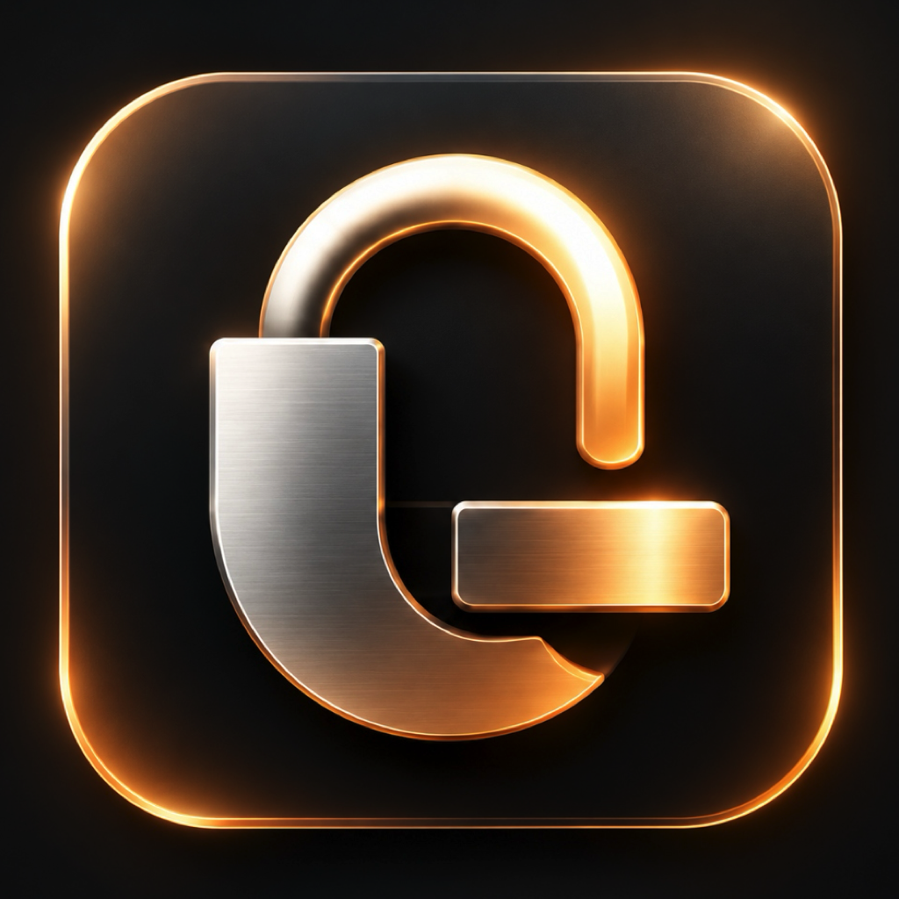

<h1 align="center">
   
  
   
  Latch
   
</h1>

<h3 align="center">Biometric Face & Touch ID App Lock for your Mac</h3>

  
  
  
  

Latch brings seamless, instant Face ID and Touch ID biometric protection to your Mac applications. Lock any sensitive app — Mail, Slack, Messages, Terminal, Photos, or Notes — and unlock it with a simple glance. 

Everything runs **100% on-device** using Apple's Vision and Core ML frameworks. Your biometric data and credentials never touch the internet, and no images are ever saved to disk. Built with fluid dynamic notch and island animations designed natively for macOS.

---

> [!NOTE]
> ### Local & Privacy-First by Design
> Latch operates completely offline. Face embeddings are calculated in memory and protected with hardware-backed AES-256-GCM encryption in the macOS Keychain. Camera frames are discarded immediately after analysis.

---

## Download & Installation

### Requirements
- **macOS**: 15.0 Sequoia or later
- **Mac**: Apple Silicon (M1/M2/M3/M4) or Intel Mac with built-in FaceTime HD or external webcam

  

### Simple Setup
1. **Download**: Grab `Latch.dmg` from the button above or the [Releases tab](https://github.com/Sensui-moksha/Latch/releases/latest).
2. **Install**: Open `Latch.dmg` and drag **Latch** into your `/Applications` folder.
3. **Launch**: Open **Latch** from `/Applications`.
   - *If macOS warns that it cannot verify or trust the developer on first open:*
     Go to **System Settings** → **Privacy & Security**, scroll down to the **Security** section, and click **Open Anyway** (or right-click `Latch.app` in Finder and select **Open** → **Open**).
4. **Follow Onboarding**: Complete the quick 30-second face enrollment and grant the requested macOS permissions.

---

## Required Permissions

| Permission | Why It's Needed | Privacy Guarantee |
|---|---|---|
| **Camera** | Detects face landmarks and computes mathematical vector embeddings. | Video frames are processed in-memory only and discarded immediately. No photos are written to disk. |
| **Accessibility** | Identifies active protected application windows to coordinate seamless locking. | Restricted exclusively to window state management. No keystrokes are logged. |
| **Touch ID** | Protects the AES-256 encryption key in the macOS Keychain. | Gated by Apple Secure Enclave and `LocalAuthentication`. |

---

## How It Works

1. **Enroll Your Face**: Follow the interactive wizard to scan your face across 9 guided angles. Each frame becomes a 512-dimension vector embedding (a mathematical fingerprint) via ArcFace Core ML, and the raw image is discarded.
2. **Select Apps to Protect**: Choose which applications you want to secure from the Latch menu bar or Settings.
3. **Launch Protected Apps**: When you open or switch to a protected app, Latch activates the Dynamic Notch overlay.
4. **Instant Unlock**: Once your face matches and liveness checks confirm you are present, the app unlocks in milliseconds. If the camera is covered or unavailable, you can fall back to Touch ID anytime.

---

## Key Features

| Feature | Description |
|---|---|
| **Face & Touch ID App Lock** | Lock any application on your Mac behind biometric authentication. |
| **100% On-Device Processing** | All ML inference runs locally via Apple Vision and Core ML. Zero cloud connections. |
| **Smart Liveness Detection** | Analyzes 3D depth parallax, blink cues, and screen reflections to reject printed photos and phone screen spoofs. |
| **Fluid Dynamic Notch UI** | Clean, interactive notch animations that expand and collapse smoothly with trackpad haptics. |
| **Notchless Mac Support** | Macs without a camera notch display a floating dynamic pill design. |
| **Multi-Identity Support** | Enroll multiple profiles (or yourself with glasses/beard/different lighting) and toggle them as needed. |
| **Automatic Updates** | Secure in-app updates delivered exclusively through official [GitHub Releases](https://github.com/Sensui-moksha/Latch/releases). |

---

## Privacy & Security

- **Zero Cloud Calls**: Latch has no external servers, no tracking, and no telemetry.
- **Encrypted Biometrics**: Embeddings are encrypted using **AES-256-GCM**.
- **Secure Enclave Backed**: The symmetric key is stored in the macOS Keychain under `kSecAttrAccessibleAfterFirstUnlockThisDeviceOnly`.
- **Fail-Closed Architecture**: Protected applications remain locked if biometric verification fails, times out, or encounters errors.
- **Signed Updates**: Software updates delivered via Sparkle are cryptographically signed with an Ed25519 key and validated before installation.

---

## Documentation

Comprehensive guides are available in the [`docs/`](docs/) directory:

- [Getting Started & Setup Guide](docs/GETTING_STARTED.md)
- [System Architecture](docs/ARCHITECTURE.md)
- [Security & Threat Model](docs/SECURITY.md)
- [Release Pipeline & Sparkle Updates](docs/RELEASES_AND_UPDATES.md)
- [FAQ & Troubleshooting](docs/FAQ_AND_TROUBLESHOOTING.md)

---

## Source Code

Latch is currently distributed as signed binary releases. The complete source code repository will be made publicly available in an upcoming milestone release.

---

## Acknowledgements

- **[Glance](https://tryglance.app)** (Jonathan Zhou) — for the pioneering on-device face recognition framework and notch UI design inspiration.
---

## Author & License
 
Created and maintained by **Mokshagna** ([@Sensui-moksha](https://github.com/Sensui-moksha)).

Copyright © 2026 Mokshagna. All Rights Reserved.  
Protected under proprietary copyright law. Unauthorized copying, distribution, modification, reverse engineering, or reproduction of software or concepts is strictly prohibited. See [LICENSE](LICENSE) for full legal terms.
