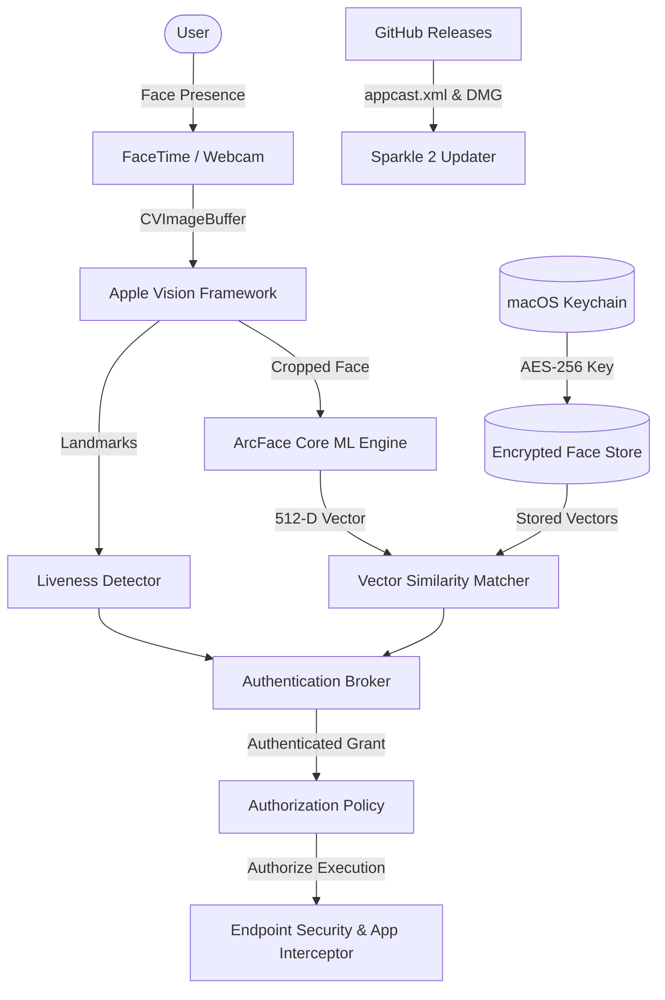

# Latch System Architecture

This document describes the architectural design and component interactions within **Latch**.

---

## Architectural Overview

Latch is designed around defense-in-depth, least privilege, and strict on-device processing:

---

## Component Breakdown

### 1. Presentation & Interaction (UI Layer)
- **Menu Bar Extra**: Lightweight, non-intrusive status item providing quick toggle access, identity switching, and configuration.
- **Dynamic Notch Overlay**: Built on top of AppKit and SwiftUI with smooth spring animations. Expands from the MacBook display notch (or a floating dynamic pill on notchless displays) during biometric verification, with haptic feedback.
- **Settings System**: Pure SwiftUI configuration view organized into modular sections (Identity Management, Protected Applications, Security & Liveness Strictness, Hardware Settings, About).

### 2. Biometric Engine
- **Face Landmark Detection**: Utilizes Apple's native `VNSequenceRequestHandler` and `VNDetectFaceLandmarksRequest` for high-throughput, low-latency face alignment.
- **ArcFace Feature Extraction**: An optimized Core ML model produces a 512-dimensional normalized feature vector for each enrolled face.
- **Cosine Similarity Matching**: Computes cosine similarity between current real-time embeddings and stored reference vectors, enforcing configurable acceptance thresholds.
- **Multi-Cue Liveness Detection**:
  - *Denial Cues*: Screen glare reflection, device bezel boundaries, static planar orientation fail the scan immediately.
  - *Confirmation Cues*: Natural blink intervals, multi-angle landmark parallax, physiological micro-movements.

### 3. Secure Storage Layer
- **No Raw Images Stored**: Camera frames are discarded immediately after embedding generation.
- **Cryptographic Isolation**: Embeddings are serialized and encrypted using **AES-256-GCM** with unique nonces.
- **Keychain Guard**: The encryption key is generated on-device and stored in the macOS Keychain under `kSecAttrAccessibleAfterFirstUnlockThisDeviceOnly`, protected by Touch ID and Secure Enclave presence.

### 4. Application Interception & Authorization
- **Interception Boundary**: Process launches are intercepted using macOS Endpoint Security / Accessibility boundaries.
- **Authorization Grants**: Short-lived, memory-bound authorization tokens validate process PID, bundle identifier, and code signature before allowing execution.
- **Fail-Closed Guarantee**: In case of process crashes, invalid signatures, or biometric timeouts, target applications remain locked.

### 5. Update & Distribution System
- **Sparkle 2 Updater**: Native framework for seamless delta and full updates directly from GitHub Releases.
- **Cryptographic Validation**: Every release binary (`Latch.dmg`) is validated using an **Ed25519 (EdDSA)** public key embedded in `Info.plist` before extraction or replacement.
