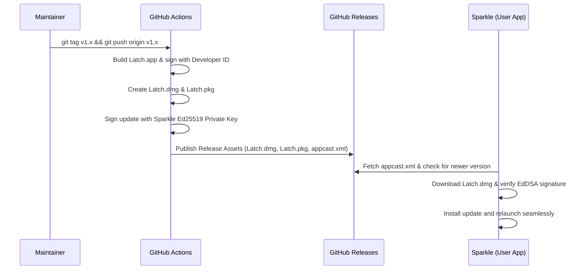

# Releases & Update Distribution

This document details how updates are packaged, signed, and distributed to **Latch** users via GitHub Releases and the Sparkle framework.

---

## Update Mechanism Overview

Latch delivers automatic, in-app updates using **Sparkle 2**. Updates are distributed exclusively through the official GitHub Releases tab of the repository (`Sensui-moksha/Latch`).



---

## Maintainer Workflow: Publishing a New Release

### Step 1: Update Version Numbers
Before tagging a release, increment the version numbers in Xcode:
1. `MARKETING_VERSION` (e.g., `1.1`)
2. `CURRENT_PROJECT_VERSION` (e.g., `2`)

### Step 2: Build & Package the Release
Run the local release build and packaging scripts:
```bash
# 1. Compile production distribution
./scripts/build_distribution.sh

# 2. Package into Latch.dmg and Latch.pkg
./scripts/package_release.sh
```

### Step 3: Sign the Update with Sparkle
Generate the EdDSA signature for the new `Latch.dmg`:
```bash
./scripts/update_appcast.sh
```
This produces the `sparkle:edSignature` and file `length` required by `appcast.xml`.

### Step 4: Add New Item to `appcast.xml`
In `appcast.xml`, add the new `<item>` entry with:
- Release title and notes
- `sparkle:version` (build number)
- `sparkle:shortVersionString` (marketing version)
- Download URL pointing to `https://github.com/Sensui-moksha/Latch/releases/download/v<version>/Latch.dmg`
- The generated `sparkle:edSignature` and length

### Step 5: Tag and Push
Commit `appcast.xml` and push the git tag:
```bash
git add appcast.xml
git commit -m "chore: release v1.1 update feed"
git tag v1.1
git push origin main --tags
```

The GitHub Actions workflow `.github/workflows/release.yml` will automatically build the release artifacts and attach `Latch.dmg`, `Latch.pkg`, and `appcast.xml` to the GitHub release.

---

## User Update Experience

1. **Automatic Background Check**: Latch periodically checks `https://raw.githubusercontent.com/Sensui-moksha/Latch/main/appcast.xml`.
2. **Manual Check**: The user can open **Settings** → **About** and click **Check for Updates**.
3. **Prompt & Changelog**: When an update is detected, Sparkle displays release notes and an **Install and Relaunch** button.
4. **Signature Verification**: Sparkle checks the cryptographic signature using the public key embedded in `Latch.app/Contents/Info.plist`:
   ```xml
   <key>SUPublicEDKey</key>
   <string>9fbFN/c7AYvtyUETXcDTEtsFWLZ5o1EGVkqswULZw/I=</string>
   ```
5. **Seamless Upgrade**: If valid, the update is mounted, extracted, swapped in `/Applications/Latch.app`, and reopened without user friction.
 
---

## Code Signing Policy: Ad-Hoc Signing for Public Releases

When releasing public versions to GitHub without a paid Apple Developer ID certificate ($99/yr):

- **Always use Ad-Hoc Signing (`SIGNING_IDENTITY="-"`)**:
  Ad-hoc signing (`codesign --sign -`) signs the application bundle for execution on macOS without embedding Apple Development provisioning profiles.
  
- **Why Apple Development Signing Must NOT Be Used for Distribution**:
  Free personal Apple Development profiles (`.provisionprofile`) have two severe limitations:
  1. **7-Day Expiration**: Apple revokes personal profiles after exactly 7 days, causing macOS to kill the app with POSIX error 163 (`Launchd job spawn failed`).
  2. **Device Hardware Lock**: Personal profiles contain an explicit list of provisioned device UDIDs. Distributing a build signed with a personal profile causes the app to fail immediately on any machine other than the developer's Mac.

- **User First-Launch Experience**:
  Ad-hoc signed binaries have no device lock and no expiration date. On first open, macOS Gatekeeper informs the user that the developer is unidentified. Users run the app by right-clicking `Latch.app` → **Open**, or by clicking **Open Anyway** in **System Settings → Privacy & Security**.

- **Restoring Keychain / Resolving Signature Mismatches**:
  If switching between development builds and distribution releases causes a `Keychain error: A required entitlement is not present` or locked session state, reinstall the application by dragging `Latch.app` into `/Applications` and replacing the existing file. Reinstalling updates the system's bundle signature registration and restores keychain access group bindings.

